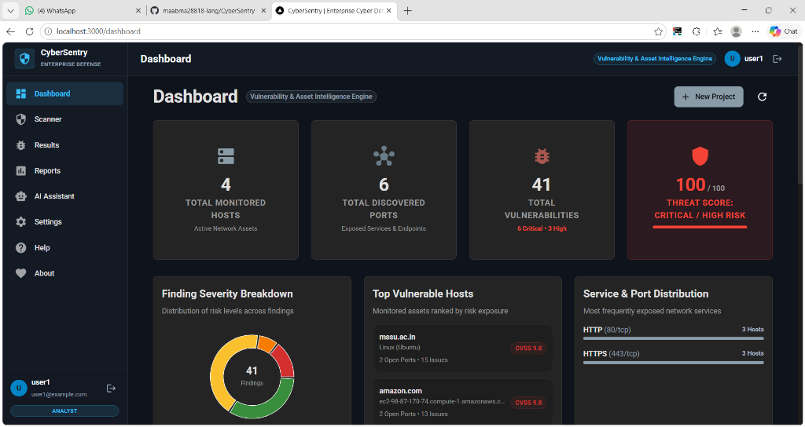
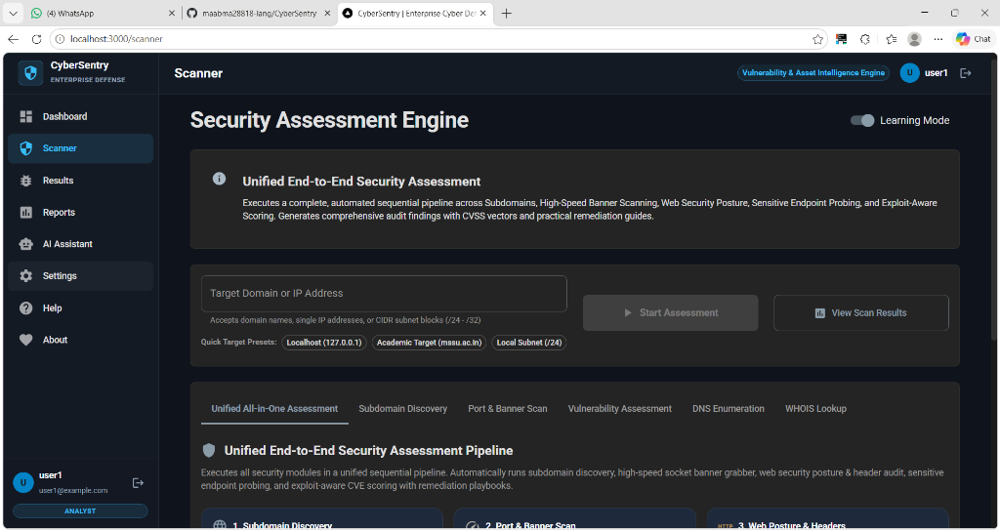
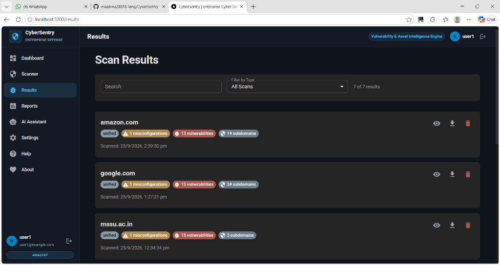
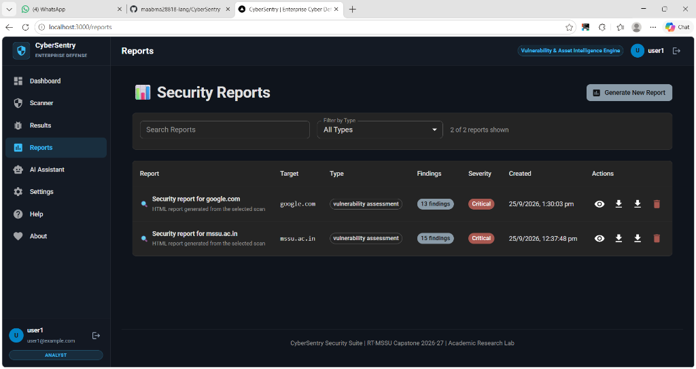

# CyberSentry 🛡️

**Enterprise Vulnerability Assessment & Asset Intelligence Engine**  
*RT-MSSU Capstone 2026–27 | Academic Research Lab*

[](https://www.python.org/)
[](https://reactjs.org/)
[](https://flask.palletsprojects.com/)
[](backend/app.py)
[](LICENSE)
[](https://github.com/maabma28818-lang/CyberSentry)

---

## 📌 Overview

**CyberSentry** is an automated, enterprise-grade cybersecurity assessment and reconnaissance platform built for vulnerability auditing, infrastructure mapping, and threat intelligence. Designed as part of the **RT-MSSU Capstone Research Project**, CyberSentry bridges the gap between raw scanning outputs and executive decision-making by combining high-speed network discovery, web security posture analysis, exploit-aware CVSS vulnerability scoring, AI-powered remediation guidance, and multi-format reporting.

---

## 🖥️ Platform Interface & Screenshots

### 1. Centralized Threat Intelligence Dashboard
Real-time visibility into active network assets, exposed services, aggregate threat scores (100/100 risk weighting), finding severity breakdown doughnut charts, top vulnerable hosts (`mssu.ac.in`, `amazon.com`), and service & port distributions.



---

### 2. Security Assessment Engine (Scanner)
Unified scanning hub featuring an automated End-to-End Pipeline alongside targeted modules for Subdomain Discovery, Socket Port & Banner Scanning, Vulnerability Audits, DNS Reconnaissance, and WHOIS Intelligence with built-in presets (Localhost, Academic Target `mssu.ac.in`, Local Subnet `/24`) and Learning Mode.



---

### 3. Comprehensive Scan Results & Finding Tracker
Filter, inspect, and drill down into discovered misconfigurations, open services, and critical CVEs with granular CVSS vectors and asset associations (`amazon.com`, `google.com`, `mssu.ac.in`).



---

### 4. Executive Security Reports Hub
Generate, archive, view, and export styled HTML and publication-ready PDF security audit reports.



---

## 📄 Sample Executive Assessment Report

CyberSentry produces structured, executive-grade assessment reports containing:
- **Section 1: Executive Summary & Network Health Index** (Threat Score Matrix & 0–100 risk index)
- **Section 2: Asset Inventory Matrix** (Discovered IPs, Canonical Hostnames, Inferred OS, and Open Services)
- **Section 3: Prioritized Vulnerability Register** with CVSS v3.1 scores, CWE classifications, and CISA KEV / EPSS threat percentiles
- **Section 4: Actionable Remediation Guide** with copy-paste Nginx and Apache hardening configurations (Server Header Disclosures, Content Security Policy, HSTS, X-Content-Type-Options, Permissions-Policy)

> 📥 **Download / View Sample Report**:  
> [**docs/CyberSentry_Enterprise_Assessment_Report_Sample.pdf**](docs/CyberSentry_Enterprise_Assessment_Report_Sample.pdf)

---

## ✨ Key Features & Capabilities

| Module | Core Functionality |
|---|---|
| 🚀 **Unified Security Pipeline** | Executes sequential subdomain discovery, socket port scanning, HTTP security posture verification, sensitive path probing, and vulnerability evaluation in a single automated workflow. |
| 🌐 **Subdomain & Recon Engine** | Multi-threaded DNS enumeration, Certificate Transparency log querying, and zone analysis for discovering shadow assets. |
| 🔌 **High-Speed Port & Banner Scanner** | Concurrent TCP/UDP port discovery with service version detection and operating system fingerprinting. |
| 🛡️ **Web Security Posture Auditor** | Inspects HTTP response headers (CSP, HSTS, X-Content-Type-Options, Permissions-Policy, Referrer-Policy, CORS, and cookie flags like `HttpOnly` and `Secure`). |
| 🔍 **Sensitive Endpoint Prober** | Probes for exposed configuration files, environment variables (`.env`), version control folders (`.git`), admin panels, and backup directories. |
| ⚠️ **Vulnerability & Threat Scoring** | Calculates dynamic threat indices and assigns CVSS v3.1 severity ratings, referencing known vulnerabilities and CISA KEV status. |
| 🤖 **AI-Assisted Guidance** | Provides contextual remediation playbooks, plain-English finding explanations, and interactive security consultations. |
| 📊 **Multi-Format Reporting** | Generates executive PDF reports via ReportLab and responsive, interactive HTML audit reports. |
| 🔐 **Role & Token Authentication** | JWT-authenticated backend APIs and protected frontend routes for analysts and administrators. |

---

## 🏗️ Architecture

```
CyberSentry/
├── backend/                  # Python Flask API & Scanning Engine
│   ├── app.py                # Main server & REST API endpoints
│   ├── modules/
│   │   ├── scanner.py        # Port scanner & network prober
│   │   ├── reconnaissance.py # DNS, WHOIS & Subdomain finder
│   │   ├── vuln_engine.py    # Vulnerability detection & CVSS engine
│   │   ├── service_auditor.py# HTTP header & sensitive file prober
│   │   ├── ai_assistant.py   # AI intelligence & triage assistant
│   │   └── report_generator.py# PDF & HTML report builder
│   ├── models/               # SQLAlchemy database models
│   └── tests/                # Automated test suites
├── frontend/                 # React SPA Dashboard
│   ├── public/               # Static assets & HTML template
│   └── src/
│       ├── components/       # Dashboard, Scanner, Results, Reports, Auth
│       ├── context/          # AuthContext & ScanContext state
│       └── services/         # API client & backend connectors
├── cli/                      # Command-line interface toolkit
├── docs/                     # Documentation, screenshots & sample reports
│   ├── screenshots/          # Platform preview captures
│   └── CyberSentry_Enterprise_Assessment_Report_Sample.pdf
├── start.bat                 # One-click Windows startup script
├── start.ps1                 # PowerShell launcher
└── docker-compose.yml        # Multi-container orchestration
```

---

## 🚀 Quick Start

### Option 1: One-Click Startup (Windows)

Simply double-click `start.bat` or run:

```powershell
.\start.ps1
```

This will automatically start the Flask backend on `http://localhost:5000` and the React frontend on `http://localhost:3000`.

---

### Option 2: Manual Setup

#### Prerequisites
- **Python 3.10+**
- **Node.js 18+** & **npm**
- **Nmap** (optional, for raw SYN scanning)

#### 1. Backend Setup
```bash
cd backend
python -m venv venv

# Windows:
.\venv\Scripts\activate
# Linux/macOS:
# source venv/bin/activate

pip install -r requirements.txt
python app.py
```
*Backend runs on `http://127.0.0.1:5000`*

#### 2. Frontend Setup
```bash
cd ../frontend
npm install
npm start
```
*Frontend runs on `http://localhost:3000`*

---

### Option 3: Docker Deployment

```bash
# Build and launch all services
docker compose up --build -d
```

---

## 💻 CLI Usage

CyberSentry includes a standalone command-line tool for automated terminal scans:

```bash
# Subdomain reconnaissance
python cli/network_scanner_cli.py subdomain example.com

# Port scan with custom range
python cli/network_scanner_cli.py port 192.168.1.1 --port-range 1-1000

# Vulnerability scan
python cli/network_scanner_cli.py vuln https://example.com --scan-type web

# Export report
python cli/network_scanner_cli.py report scan_results.json --format pdf
```

---

## 🛡️ Security & Responsible Use

> **Disclaimer**: CyberSentry is built strictly for educational, research, and authorized security assessments. Always obtain explicit written permission before performing security evaluations against any system or network.

---

## 👥 Authors & Academic Credits

- **Author / Lead Developer**: [Md. Abdullah](https://github.com/maabma28818-lang)
- **Institution**: RT-MSSU Academic Research Lab | Capstone Project 2026–27
- **GitHub**: [@maabma28818-lang](https://github.com/maabma28818-lang)
- **Repository**: [https://github.com/maabma28818-lang/CyberSentry](https://github.com/maabma28818-lang/CyberSentry)

---

## 📜 License

This project is licensed under the MIT License — see the [LICENSE](LICENSE) file for details.
